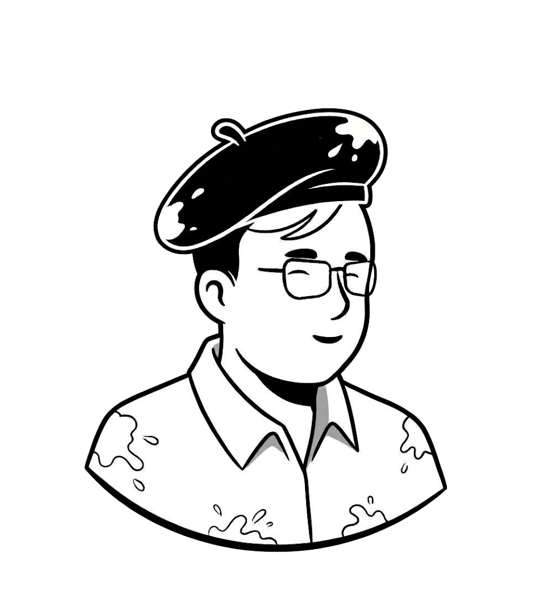
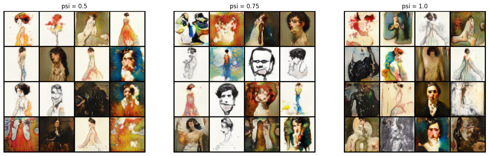
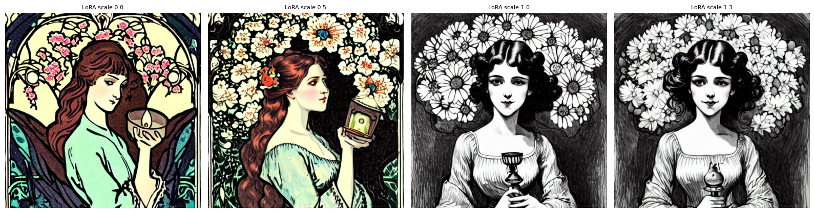
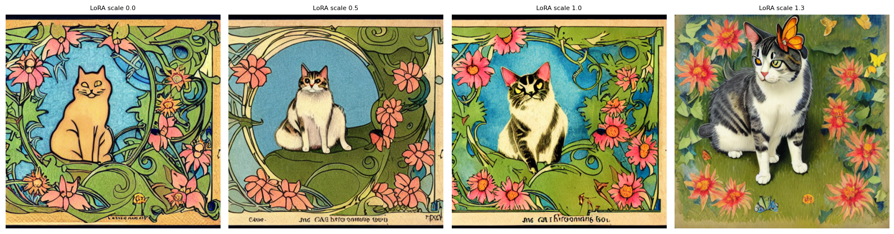

# Picasso

Picasso is a project for learning and generating **Art
Nouveau** artwork with several generative-model approaches. It demonstrates
the progression from training a GAN from scratch, to a style-based WGAN, to
adapting a pretrained latent diffusion model with parameter-efficient
fine-tuning.

<div align="center">
  

  
  
  
</div>  


## What this project demonstrates

| Model | Training approach | Notebook |
| --- | --- | --- |
| StyleGAN | Style-based generator with WGAN-GP and adaptive discriminator augmentation (ADA) | [`notebooks/stylegan.ipynb`](./notebooks/stylegan.ipynb) |
| Latent diffusion | Stable Diffusion 1.5 fine-tuned with LoRA adapters on Art Nouveau images | [`notebooks/finetune_latent_diffusion.ipynb`](./notebooks/finetune_latent_diffusion.ipynb) |

## Highlights

- Trains a style-based WGAN with gradient penalty, style mixing, and optional
  ADA to improve stability on a relatively small image collection.
- Fine-tunes only low-rank LoRA adapters in the UNet attention layers of
  Stable Diffusion 1.5; the base model, VAE, and text encoder remain frozen.
- Compares baseline and fine-tuned diffusion samples using the same prompts
  and seeds, then reloads the saved LoRA weights for inference.
- Includes reusable model, augmentation, data, and trainer modules under
  [`picasso`](./picasso).

## Repository structure

```text
picasso/
├── notebooks/
│   ├── stylegan.ipynb           # Style-based WGAN-GP + ADA
│   └── finetune_latent_diffusion.ipynb  # Stable Diffusion + LoRA
├── picasso/
│   ├── data/                    # Dataset download utilities
│   ├── models/                  # GAN, augmentation, and diffusion modules
│   └── trainers/                # Reusable training and inference loops
├── checkpoints/                 # Saved model and LoRA weights
├── datasets/                    # Local datasets (not required to clone)
└── samples/                     # Training and sample visualizations
```

## Getting started

The project requires Python 3.10–3.13. A CUDA-capable GPU is recommended for
training; the StyleGAN code automatically uses CUDA when available, while
diffusion fine-tuning requires a GPU unless it is explicitly run as a smoke
test with `--allow-cpu`.

Install the project dependencies with Poetry:

```bash
poetry install
```

Or install the pinned requirements directly:

```bash
pip install -r requirements.txt
```

Launch Jupyter from the repository root:

```bash
poetry run jupyter lab
```

Then open one of the notebooks in [`notebooks`](./notebooks).

### Downloading data

The download helper can retrieve selected files or folders from any Hugging
Face Hub repository. From the repository root, run:

```bash
python picasso/data/download_data.py <owner>/<dataset> \
  --prefix <folder> --out datasets
```

Use `--dry-run` to inspect the files and total size before downloading. The
Art Nouveau training data should be placed under `datasets/art-nouveau` for
the diffusion trainer, or under an image-folder directory for the StyleGAN
trainer.

### Running the trainers

StyleGAN training:

```bash
python picasso/trainers/stylegan_trainer.py \
  --datapath datasets/art-nouveau \
  --epochs 5 \
  --ckpt_path checkpoints/stylewgan_ckpt.pt
```

Resume from the checkpoint with `--resume`. Disable adaptive augmentation with
`--no_ada`.

LoRA fine-tuning:

```bash
python picasso/trainers/sd_lora_trainer.py finetune \
  --data datasets/art-nouveau \
  --out checkpoints/lora_output
```

The fine-tuning command saves LoRA weights, resumable training state,
validation samples, and loss plots in the output directory. Generate images
later without the dataset:

```bash
python picasso/trainers/sd_lora_trainer.py generate \
  "an illustration in art nouveau style, a cat in a flower garden" \
  --out-dir checkpoints/lora_output \
  --scales 0 0.5 1
```

## Available Models

### StyleGAN2-ADA (Adaptive Discriminator Augmentation)

This implementation combines a StyleGAN2-style generator with a WGAN-GP
critic. A learned mapping network transforms the latent vector `z` into the
intermediate style space `w`; those style vectors modulate the convolutional
layers at each resolution, while skip-connected ToRGB layers progressively
build the image from a learned constant input. During training, style mixing
regularization can use two latent vectors at different layers, and the
exponential moving average of the generator is used for sampling.

The critic is trained with five updates per generator update using the Wasserstein
objective, a gradient penalty, and a small drift penalty. Both real and
generated images pass through the differentiable augmentation pipeline, which
supports geometric and color transforms. ADA adjusts the augmentation
probability from held-out real-image statistics to reduce discriminator
overfitting on the relatively small Art Nouveau dataset. The default training
resolution is 64 x 64.




### Finetuned Stable Diffusion

The [`finetune_latent_diffusion.ipynb`](./notebooks/finetune_latent_diffusion.ipynb)
notebook adapts Stable Diffusion 1.5 to the Art Nouveau collection with
parameter-efficient LoRA fine-tuning. It does not train a diffusion model from
scratch: the original model weights remain frozen and only small, trainable
low-rank adapters are added to the UNet attention layers.

The notebook follows this process:

1. **Set up the runtime.** Install `diffusers`, `peft`, `transformers`,
   `accelerate`, and `safetensors`, then run on a CUDA GPU. The default
   configuration targets a 512 x 512 image size, batch size 1, gradient
   accumulation of 4, and 2,000 optimizer steps.
2. **Download and prepare the data.** It downloads the `art-nouveau` folder
   from the `StyleGender/StyleGender-Dataset` Hugging Face dataset (or reuses
   an existing local copy). Images are discovered recursively, resized so the
   short side is 512 pixels, center-cropped, optionally flipped, and normalized
   to `[-1, 1]`. Each image uses a same-name `.txt` sidecar caption when
   available; otherwise the default caption, `an illustration in art nouveau
   style`, is used.
3. **Load the pretrained components.** Stable Diffusion's VAE, UNet, CLIP
   tokenizer, text encoder, and noise scheduler are loaded from the Hub. The
   VAE converts images into latent representations and the text encoder
   provides prompt conditioning; the VAE and text encoder are kept frozen.
4. **Attach LoRA and define the objective.** LoRA adapters (rank 16 by
   default) are attached to the UNet. For each batch, the notebook encodes the
   images into latents, samples a random diffusion timestep and Gaussian noise,
   adds that noise to the latents, and trains the UNet to predict the noise
   using a weighted mean-squared-error loss. Mixed precision, gradient
   checkpointing, gradient accumulation, and min-SNR weighting reduce memory
   use and improve training efficiency.
5. **Compare before and after.** Baseline images are generated before training
   with fixed prompts and seeds. During training, validation images are
   regenerated every 500 steps, and the loss history is plotted so the style
   adaptation can be compared without changing the sampling conditions.
6. **Save and reuse the adapter.** The notebook saves
   `lora_output/pytorch_lora_weights.safetensors` and a resumable
   `training_state.pt` checkpoint every 500 steps and at the end of training.
   For inference, it loads a fresh Stable Diffusion 1.5 pipeline and applies
   the saved LoRA weights; the LoRA scale can be adjusted from the base model
   (`0`) toward the full adapted style (`1`).

<div style="padding: 15px; border-left: 5px solid #8a2be2; background-color: #f3e8ff; border-radius: 4px; margin: 10px 0;">
    <strong style="color: #140522;">🔮 PROMPT</strong><br>
    <span style="color: #180827;">An illustration in art nouveau style, a young woman holding a lantern among flowers.</span>
</div>



<div style="padding: 15px; border-left: 5px solid #8a2be2; background-color: #f3e8ff; border-radius: 4px; margin: 10px 0;">
    <strong style="color: #140522;">🔮 PROMPT</strong><br>
    <span style="color: #180827;">An illustration in art nouveau style, a cat in a forest with flowers and butterflies.</span>
</div>


